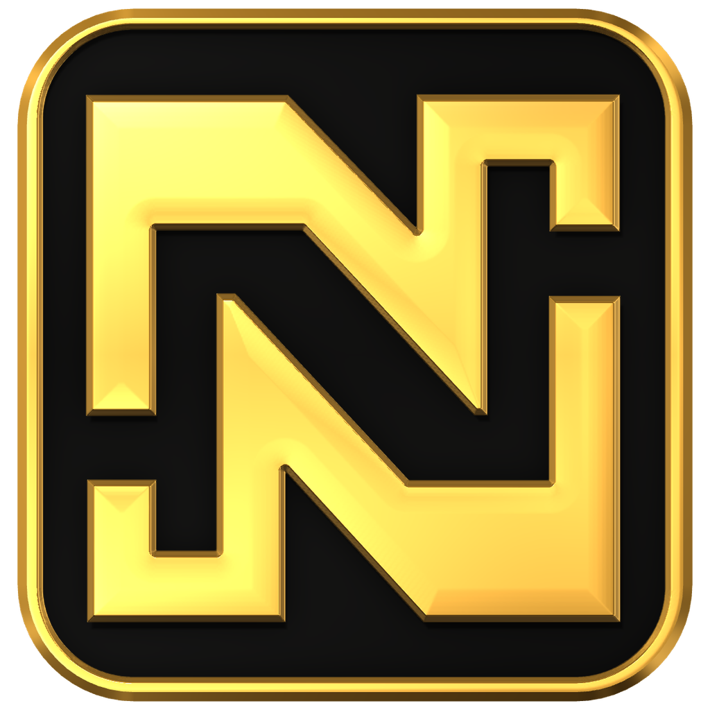

<p align="center">
  
</p>

# Nirvani for Claude

Run your Nirvani workspace from Claude in plain language. Find and update contacts, move deals through pipelines, check calendar availability and book appointments, read conversations, and send SMS or email to a contact. Every action runs as you, inside the workspace you choose, with the permissions you grant at sign-in.

This repository is the official Claude plugin for Nirvani. It connects Claude to the Nirvani remote MCP server at `https://mcp.nirvani.ai/mcp` and adds the `nirvani-workspace` skill, which teaches Claude how to work safely with your workspace data.

[](https://github.com/Nirvani-Company/nirvani-claude-plugin/actions/workflows/ci.yml)
[](LICENSE)

## Install

### Claude Code

Claude Code 2.1.275 or later:

```
/plugin install nirvani --marketplace Nirvani-Company/nirvani-claude-plugin
```

Earlier versions take two steps:

```
/plugin marketplace add Nirvani-Company/nirvani-claude-plugin
/plugin install nirvani@nirvani
```

The first time Claude calls a Nirvani tool, it opens the Nirvani sign-in page in your browser.

### Claude on the web, desktop and mobile

Add Nirvani as a connector: open **Settings**, then **Connectors**, choose **Add custom connector**, and enter `https://mcp.nirvani.ai/mcp`. On Team and Enterprise plans an owner adds the connector once for the organization.

## Before you connect

Your email must belong to a Nirvani workspace that is enabled for Claude. Your Nirvani admin enables the workspace and adds members. If sign-in says your email is not recognized, ask your admin to add you.

## Sign in

1. Enter your work email on the Nirvani sign-in page, then the six digit code sent to that address.
2. Pick your workspace if you belong to more than one.
3. Review the permissions and choose **Allow**.

| Permission | Scope | What it allows |
| --- | --- | --- |
| Read | `nirvani:read` | Search and read contacts, deals, pipelines, calendars, appointments and conversations. |
| Write | `nirvani:write` | Create and change contacts and deals, book appointments, and send messages. |

Sign-in uses OAuth 2.1 with PKCE (S256). Claude receives a scoped access token only: never your sign-in code, and never your workspace's platform credentials.

## What you can ask

- "Find Dana Ortiz and show me her open deals."
- "Move the Lakeside Dental deal to Proposal Sent and set the value to 6,000."
- "What times are free on the consultation calendar next Tuesday? Book Sam Lee at the first one."
- "Read my last conversation with Jordan and draft a reply."
- "Add the tag `vip` to everyone I talked about above."

Before any change, Claude states exactly what will change and asks you to confirm. After a change, it reports the record id.

## Tools

The connector exposes eighteen tools. Read tools never change data. Write tools change customer records or send real messages.

### Read

| Tool | What it does |
| --- | --- |
| `nirvani_whoami` | Show which workspace and user this connection acts as, its timezone, and what it is allowed to do. |
| `nirvani_contacts_search` | Find contacts by name, email, phone or company. |
| `nirvani_contact_get` | Read one contact's full profile. |
| `nirvani_pipelines_list` | List sales pipelines and their stages. |
| `nirvani_opportunities_search` | Find deals by name, pipeline, stage, status or contact. |
| `nirvani_calendars_list` | List booking calendars. |
| `nirvani_calendar_events_list` | List appointments in a date range, optionally for one calendar or user. |
| `nirvani_calendar_free_slots` | List open booking slots for a calendar between two dates. |
| `nirvani_conversations_search` | Find message threads, optionally for one contact or by text. |
| `nirvani_conversation_messages` | Read the recent messages in one conversation. |

### Write

| Tool | What it does |
| --- | --- |
| `nirvani_contact_create` | Create a contact. |
| `nirvani_contact_update` | Change fields on a contact. Overwrites the fields passed. |
| `nirvani_contact_add_tags` | Add tags to a contact. |
| `nirvani_contact_add_note` | Add a note to a contact's timeline. |
| `nirvani_opportunity_create` | Create a deal for a contact in a pipeline stage. |
| `nirvani_opportunity_update` | Move a deal to another stage, or change its status, value, name or owner. Overwrites the fields passed. |
| `nirvani_appointment_book` | Book an appointment for a contact on a calendar. |
| `nirvani_message_send` | Send an SMS or email to one contact from the workspace. |

Every tool carries MCP annotations (`readOnlyHint`, `destructiveHint`), so Claude can require your approval before a write runs.

## Data and security

- **No local code.** The plugin contains a server reference and a skill. It installs nothing on your machine and runs no scripts.
- **One destination.** The plugin talks only to `mcp.nirvani.ai`. That server reads and writes records in your Nirvani workspace when you ask Claude to, and nothing else.
- **Scoped access.** Each connection is limited to one workspace and to the permissions you granted. A read-only connection cannot change data.
- **Revocable.** Remove the connector in Claude, or ask your Nirvani admin to remove your access, and the connection stops working at once.

Privacy policy: https://mcp.nirvani.ai/privacy. Security reports: see [SECURITY.md](SECURITY.md).

## Troubleshooting

| Message | Cause | Fix |
| --- | --- | --- |
| Email not recognized | Your email is not a member of an enabled workspace. | Ask your Nirvani admin to add you. |
| Connection is read-only | You connected without write access. | Reconnect Nirvani in Claude and allow write access. |
| Workspace connection needs attention | The workspace's platform connection must be renewed. | Your Nirvani admin reconnects it. Nothing on your side fixes it. |
| No longer enabled, or access was removed | The workspace or your membership was turned off. | Contact your Nirvani admin. |

## Support

- Documentation: https://mcp.nirvani.ai/docs
- Help: https://mcp.nirvani.ai/support or support@nirvani.ai
- Bugs and requests: [open an issue](https://github.com/Nirvani-Company/nirvani-claude-plugin/issues/new/choose)

## Versioning

Releases follow [Semantic Versioning](https://semver.org). Each release is tagged `nirvani--v<version>` and listed in [CHANGELOG.md](CHANGELOG.md) and on the [releases page](https://github.com/Nirvani-Company/nirvani-claude-plugin/releases).

## License

[MIT](LICENSE). Copyright 2026 Nirvani Company. Nirvani and the Nirvani logo are trademarks of Nirvani Company; the license does not grant rights to them.
